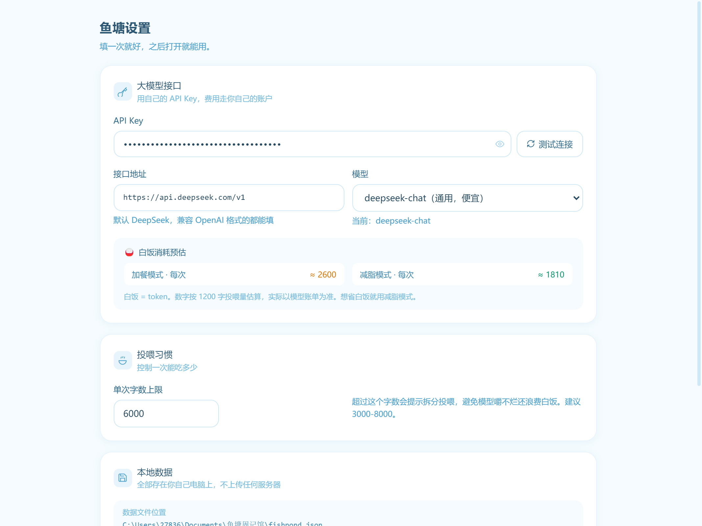
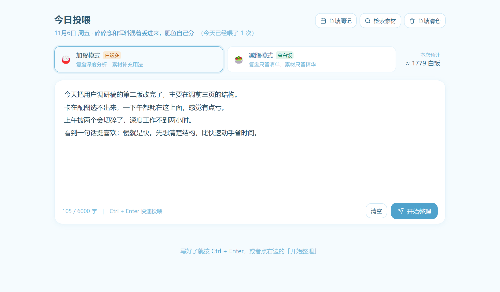
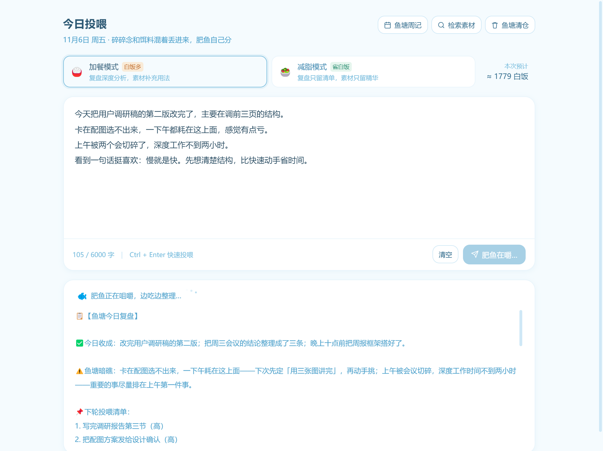
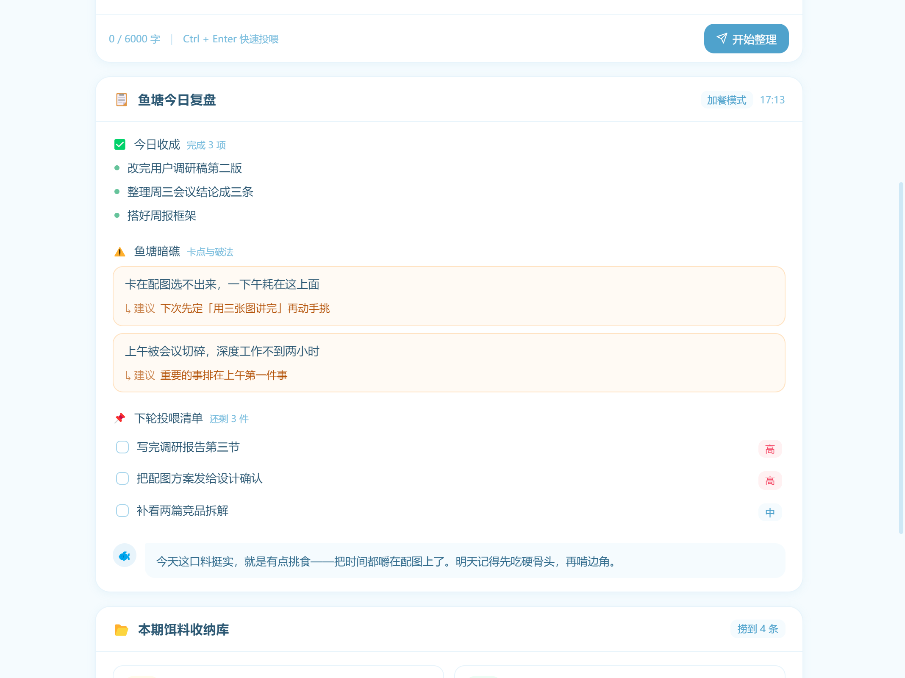
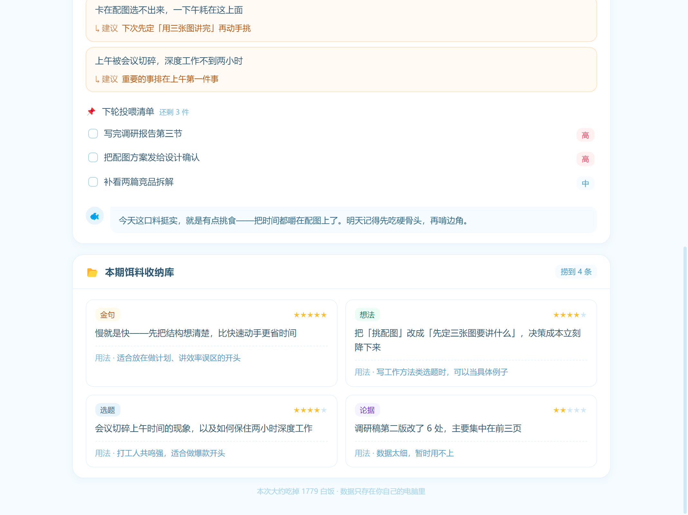
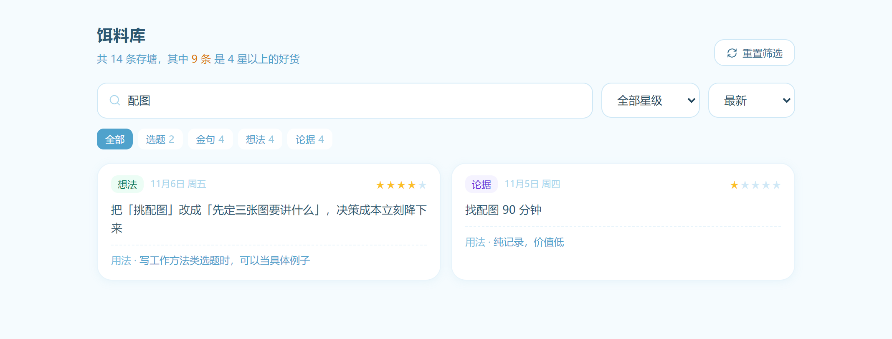
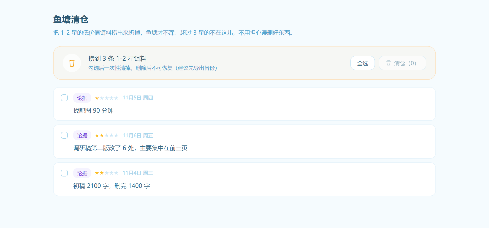
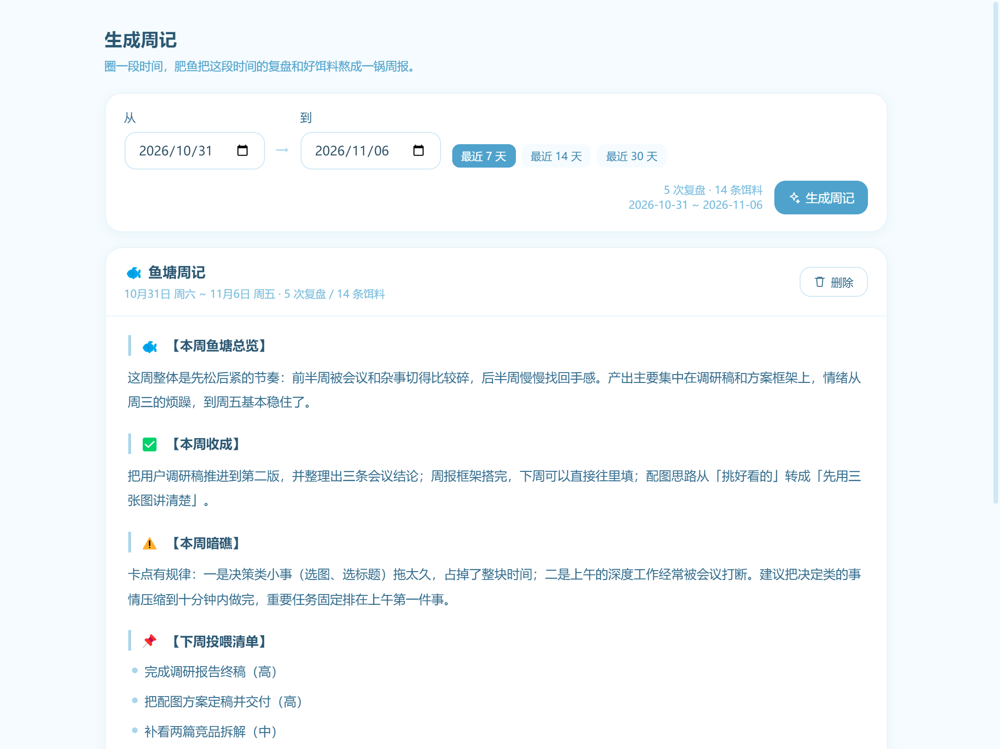
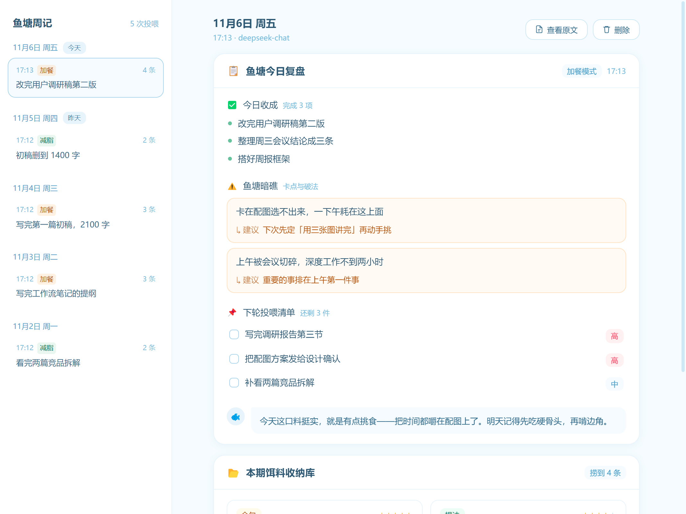

# 我把每天的碎碎念丢给一条肥鱼，一周后它还了我一个素材库

> 一个只在你自己电脑上跑的小工具：不注册、不联网、不接微信。
> 你要做的只有两件事：填一次 API Key，然后每天把脑子里的东西倒进去。

---

## 先说个扎心的事

你有没有过这种时刻：

刷到一句话，觉得特别好，赶紧复制到备忘录，然后再也没打开过；
晚上想复盘今天干了啥，打开文档，光标闪了三分钟，一个字没写；
等到真要写稿、要做分享，翻遍七八个 App，一句能用的话都想不起来。

问题不在你不努力记录，在于**记录和用起来之间，隔着十万八千里**。

我花了两个周末，做了个只在电脑上跑的小工具，叫「鱼塘周记馆」。它只干一件事：

**你把当天所有乱七八糟的东西一股脑倒进去，它帮你分成两份——今天该复盘什么，哪些句子值得存起来当素材。**

下面是我自己用了一周之后的完整流程，全程不超过 3 分钟一天。

---

## ① 装好，填一次 Key 就完事

双击安装包，装完打开，直接就是主界面。

第一次用要去设置页填一个 API Key，填完这辈子都不用再管了。默认接的是 DeepSeek，也支持任何 OpenAI 格式的接口，成本大概几厘钱一次。

设完点一下「测试连接」，出现「通了」就说明没问题了。

---

## ② 一天的内容，一股脑丢进去

这是整个工具最爽的地方：**不用分类**。

今天干了什么、卡在哪、被谁气到、刷到的一句话、突然想到的选题，全混在一起，扔进输入框就行。

我当天写的是这样的：

> 今天把用户调研稿的第二版改完了，主要在调前三页的结构。
> 卡在配图选不出来，一下午都耗在这上面，感觉有点亏。
> 上午被两个会切碎了，深度工作不到两小时。
> 看到一句话挺喜欢：慢就是快。

没有分段、没有小标题、没有格式。想到哪写到哪，写完按 `Ctrl + Enter`。

---

## ③ 选个模式：今天想加餐，还是减脂

输入框上方有两个模式，区别很实在：

- **加餐模式**：复盘讲透，卡点会给原因和建议，素材还会补一句「这个能用在哪」。白饭（token）花得多一点。
- **减脂模式**：复盘只留待办清单，素材只留标签和一句摘要。省白饭，适合赶时间或者当天没什么好复盘的。

右边那个数字是实时预估的白饭消耗，写多少字花多少钱，一眼能看到，不会有「用超了」的意外。

---

## ④ 等它嚼一会儿

点「开始整理」，页面会往上滚，你能看见它一个字一个字往外吐。

一般 3 到 8 秒，看你写多少。这个过程挺治愈的，像看着鱼缸里的鱼在吃东西。

---

## ⑤ 你得到两块东西：一份复盘，一个素材库

### 第一块：今日复盘

四个部分，固定结构，不会今天一个样明天一个样：

- **今日收成**：今天真正完成的事，它帮你从一堆废话里拎出来
- **鱼塘暗礁**：卡点，而且每条后面跟着一句能落地的小建议
- **下轮投喂清单**：明天要做的事，标了高/中优先级，做完可以打勾
- **肥鱼点评**：一句吐槽或者鼓励，不长，但挺准

比如我那天写「卡在配图选不出来」，它给的建议是「下次先定用三张图讲完，再动手挑」——这种具体到能马上执行的话，比「你要提高效率」有用一百倍。

### 第二块：本期饵料收纳库

素材会被自动打上分类（**选题 / 金句 / 想法 / 论据**）、打 1–5 星，再配一句提纯摘要和一个使用备注。

注意里面那条 2 星的「调研稿第二版改了 6 处」——它自己判断这条价值低，所以只给了 2 星。这种自动分级，后面清仓的时候特别省事。

**到这一步，你什么额外操作都不用做，素材已经进库了。**

---

## ⑥ 素材库：写稿前先来这里翻

素材越攒越多，最怕的是「存了但找不到」。

切到「饵料库」，搜关键词就行，比如我搜「配图」：

支持按标签筛、按星级筛、按时间排。看到当时给的星级现在觉得不对，点星星就能改。

我现在的习惯是：**写稿前先搜一次，把 4 星以上的捞出来看一眼**，基本不愁没东西写。

---

## ⑦ 鱼塘清仓：把没用的捞出去

低价值的东西留着只是心理安慰。

「鱼塘清仓」会自动列出所有 1–2 星的素材，勾选后一次性删掉。

我这个礼拜攒了 14 条饵料，其中 3 条是 1–2 星的（比如「找配图花了 90 分钟」这种纯记录）。每周清一次，库一直是干净的。

---

## ⑧ 生成周记：一周一次，把这些串起来

这是我最喜欢的功能。

选一段日期，它会把这段时间的所有复盘和 4 星以上的素材，压成一份周报：本周总览、收成、反复出现的暗礁、下周清单、高分素材精选。

它不只是一条条罗列，会帮你找规律。比如它说我这周的卡点是「决策类小事拖太久，占掉整块时间」——这个规律我自己完全没意识到。

历史记录都能回看，按日期排好：

---

## 用了一周，到底有什么变化

说三个真实的变化：

**第一，记录这件事的门槛没了。** 以前我要「打开笔记 → 建新文档 → 想标题 → 分类」，一套操作下来热情已经耗完。现在打开就写，写完就关。

**第二，素材终于能被用起来。** 之前散在备忘录、微信收藏、随手的纸片里，现在全在饵料库里，还能按星级筛。

**第三，复盘从「想想」变成「看见」。** 一周的暗礁摆在一起，规律特别明显，改起来也有方向。

---

## 关于数据和隐私，说清楚

- 所有内容存在你电脑里的一个 JSON 文件，路径在设置页能直接打开
- 没有云端、没有账号、不上传任何东西
- 唯一联网的地方，是把你的内容发给你自己填的那个模型接口
- 怕丢就点「导出备份」，换电脑点「导入备份」

一句话：**你的碎碎念，只属于你。**

---

## 最后

工具不解决自律问题，但它能把「记录 → 复盘 → 用起来」这条路的摩擦力降到几乎为零。

如果你也有一堆存了没用的备忘录，不妨试试把它倒进鱼塘里。

鱼养大了，自然有肉吃。🐟
